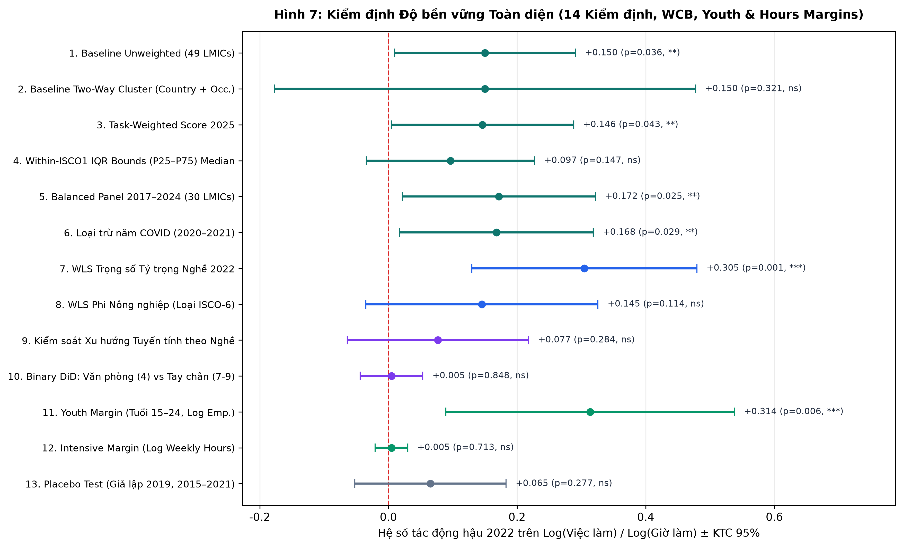
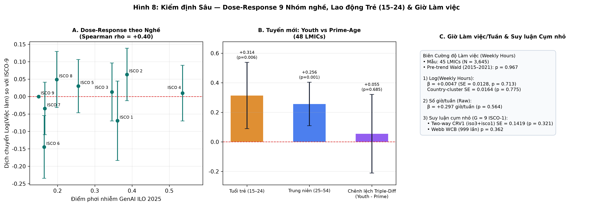

# AI Labor Shock & Skills Exposure Observatory (LMICs & Vietnam)

[](https://github.com/nguyenJRhung/ai-labor-shock-observatory/actions/workflows/ci.yml)
[](https://share.streamlit.io/deploy?repository=nguyenJRhung/ai-labor-shock-observatory&branch=main&mainModule=app/streamlit_app.py)

> **Executive Summary (BLUF — 30 giây):**  
> Các doanh nghiệp và nhà hoạch định chính sách tại các nền kinh tế thu nhập thấp & trung bình (LMICs, trong đó có Việt Nam) cần một công cụ định lượng trung thực để tách bạch **tác động thực của GenAI lên việc làm, tuyển dụng trẻ (15–24 tuổi) và giờ làm việc** khỏi nhiễu vĩ mô, rồi chuyển hóa thành **mô hình tài chính CFO-grade (NPV, Payback, CVaR 5% và Chiến lược Hybrid không sa thải)**.  
> Dự án vận hành **0 đồng**, tích hợp **ILO 2025 (P25/Median/Mean/P75 & GPT-4o/Gemini), ILOSTAT LFS + Youth + Weekly Hours + Modeled, Anthropic Economic Index, GitHub Innovation Graph và World Bank WDI**, đối chiếu chính xác **6/6 mô hình giữa Python (`pyfixest`) và R (`fixest`)**.

> **Deploy Demo Sống (1 Click trên Streamlit Community Cloud — 0đ):** Nhấn huy hiệu **Open in Streamlit** phía trên (hoặc [tại đây](https://share.streamlit.io/deploy?repository=nguyenJRhung/ai-labor-shock-observatory&branch=main&mainModule=app/streamlit_app.py)) để triển khai trực tiếp ứng dụng tương tác từ `main` dùng cấu hình nhẹ `requirements.txt` và snapshot CSV trong repo.

---

## 1. Kết quả Trọng tâm Đã Kiểm chứng Thực tế

### A. Tác động Nhân quả Vĩ mô & 14 Kiểm định Sâu (`mart_panel_causal_lfs`, $N = 3,987$, `49` LMICs)






- **Kiểm định Xu hướng Song song (Pre-trend 2015–2021):** Đạt (`Wald p = 0.274` trên Actual LFS), trong khi dữ liệu nội suy *ILO Modeled* (`124` nước, $N=9,450$) bị vi phạm (`p = 0.00051`).
- **Tác động Hậu 2022 (`post_2022 × exposure_2025`) & Bằng chứng Toàn diện (14 Kiểm định):**
  - Baseline không gia quyền ($\hat{\beta} = +0.1502, SE_{\text{unit}} = 0.0715, p = 0.0362$), `Task-Weighted Score 2025` ($+0.1463, p = 0.0430$), `GPT-4o` ($+0.1593, p = 0.0413$), `Gemini` ($+0.1347, p = 0.0461$), `WLS` tỷ trọng nghề 2022 ($+0.3046, p = 0.0007$) và Balanced Panel 2017–2024 ($+0.1718, p = 0.0252$) đều dương.
  - **Suy luận Cụm nhỏ & Xu hướng Song song Mạnh:** Khi cụm 2 chiều (`iso3 + isco1`: $SE = 0.1419, p = 0.3206$), chạy **Webb 6-point Wild Cluster Bootstrap (999 lần qua 9 cụm nghề ISCO-1)**: **`p = 0.3624`**, kiểm soát xu hướng tuyến tính theo nghề ($+0.0769, p = 0.2840$), so sánh trực tiếp Văn phòng `ISCO-4` vs. Tay chân `ISCO 7–9` ($+0.0047, p = 0.8481$), hay kiểm tra *Dose-Response* 9 nhóm nghề (`Spearman rho = +0.40, p = 0.2861`), tín hiệu tách biệt khỏi chuyển dịch rời nông nghiệp `ISCO-6` (`-0.1447, p = 0.0017`) không khác 0 về mặt thống kê.
  - **Biên Ngắn hạn Mới (`Check 13–14`):** Mở rộng dữ liệu thực từ ILOSTAT cho **Lao động Trẻ 15–24 tuổi** (`48` LMICs, Youth DiD `+0.3136, p = 0.0063`, Triple-Diff vs. `25–54` = `+0.0549, p = 0.6854`) và **Số giờ Làm việc/Tuần** (`45` LMICs, Pre-trend `p = 0.9665`, `ln_hours` `+0.0047, p = 0.7126`) xác nhận chưa có đóng băng tuyển dụng tuổi trẻ hay co rút giờ làm tại LMICs tính đến 2024–2025.
- **Đối chiếu chéo `6/6` mô hình Python `pyfixest` vs. R `fixest`:** Khớp tuyệt đối trên cả `Event Study`, `Pooled DiD (+ Two-Way CRV1)`, `Occupation Linear Trends`, `Binary Clerical vs. Manual`, `Triple-Diff Gender` và `Youth Triple-Diff` (**`max |Δβ| = 6.11e-15`**, **`max |ΔSE| = 6.18e-11`**).
- **Chuyên sâu Việt Nam (`VNM`):** `2,760,619` GitHub developers cuối 2025 (`401.7` dev / 10k dân LĐ, tăng `+123.1%` từ 2022; lên `3,244,777` ở `2026-Q2`); Anthropic **AUI toàn cầu = `0.8605`** (**`2.3984`** nội khối LMICs); tương tác *Automation* `51.8%` vs. *Augmentation* `45.6%`; `Gender Exposure Gap = +0.0174` (`0.2245` nữ vs. `0.2071` nam).

### B. Mô phỏng Tài chính CFO-Grade: 4 Chiến lược, Nghỉ việc 18%/năm, Copula Monte Carlo & VN Presets


Mô hình Layer 3 chấm dứt thiên vị chống lại *Cut & Replace* (chỉ tính gián đoạn bàn giao tỷ lệ theo quỹ lương *bị cắt*, cho phép nhân sự ở lại dùng AI tự học ở mức `35%` với độ phủ `50%`), đồng thời tính đầy đủ **tỷ lệ nghỉ việc tự nhiên `18%/năm`** (hụt năng suất làm quen + chi phí đào tạo bù `75%` + cập nhật kỹ năng `15%/năm`) và **Gaussian Copula Monte Carlo 4×4** (`rho = +0.65 / -0.35`):

| Chiến lược hành động (Mẫu 1.000 NV BPO VN, 36 tháng) | Đầu tư ban đầu | NPV Cơ sở | NPV Thận trọng (35%) | ROI (%) | Hoàn vốn | Monte Carlo & Ghi chú |
| :--- | ---: | ---: | ---: | ---: | :---: | :--- |
| **A. Status Quo (Giữ nguyên)** | 0 Tỷ | **0.00 Tỷ** | **0.00 Tỷ** | 0.0% | — | Chi phí cơ hội **`-28.30 Tỷ`** |
| **B. Fair Cut & Replace (-34 NV, Survivor AI)** | 1.89 Tỷ | **+13.96 Tỷ** | **+7.29 Tỷ** | 737.2% | Tháng 6 | Thắng pure Reskilling ở kịch bản thận trọng 35% (`+7.29B` vs `+1.51B`) |
| **C. Targeted Reskilling (520 NV, w/ 18% Attrition)** | 7.18 Tỷ | **+16.95 Tỷ** | **+1.51 Tỷ** | 236.2% | Tháng 11 | P10/P50/P90: **`+3.73 / +16.60 / +31.33 Tỷ`**; **`CVaR 5% = -1.80 Tỷ`** (`96.0% > 0`) |
| **D. Hybrid (Reskill Aug. + Đóng băng bù Auto)** | **6.72 Tỷ** | **+28.30 Tỷ** | **+9.70 Tỷ** | **421.0%** | **Tháng 8** | **0 đền bù sa thải**, đóng băng tối đa 33 ghế Auto; **`98.1%` thắng Fair Cut** (`P50 = +27.79 Tỷ`) |

- **Hiệu chuẩn theo Doanh nghiệp Thực tế Việt Nam (`presets_summary`):**
  - **FPT-Calibrated Tech & Services (`54,110` NV, BCTN FY2025 ~571.6M VNĐ/năm):** `92.68%` quỹ lương phơi nhiễm cao $\rightarrow$ Hybrid NPV **`+6,432.31 Tỷ`** vs. Reskilling **`+5,837.29 Tỷ`** vs. Fair Cut **`+1,811.16 Tỷ`** (hoàn vốn tháng `4`).
  - **Techcombank-Calibrated Banking (`12,705` NV, BCTC FY2025 ~47.5M VNĐ/tháng):** `91.99%` quỹ lương phơi nhiễm cao $\rightarrow$ Hybrid NPV **`+1,706.41 Tỷ`** vs. Reskilling **`+1,342.24 Tỷ`** vs. Fair Cut **`+642.63 Tỷ`** (hoàn vốn tháng `4`).
  - *Ghi chú minh bạch:* Tổng biên chế & chi phí nhân sự bình quân lấy từ BCTC FY2025; tỷ trọng phân bổ vào 9 mã ISCO-1 là hiệu chuẩn ngành.

---

## 2. Kiến trúc Hệ thống 3 Lớp & Kho dữ liệu

```text
[7 Tập Dữ liệu Mở: ILO 2025 (Mean/IQR/GPT4o/Gemini) + ILOSTAT LFS/Age/Hours/Modeled + AEI + GitHub + WDI]
                                      │
                                      ▼  Lớp 1: Validators + ETL + DuckDB SQL (src/etl/ + sql/01..03)
                             [data/observatory.duckdb]
                                      │
                     ┌────────────────┴────────────────┐
                     ▼                                 ▼
Lớp 2: Causal Engine (src/causal/)          Lớp 3: CFO-Grade BA Engine (src/business/)
- Saturated TWFE + 14 Checks                - Workforce Diagnostics + Macro L2->L3 Priors
- Webb Wild Bootstrap (G=9), Youth, Hours   - Fair Cut vs Reskilling vs Hybrid (0 Severance)
- Dose-Response + R fixest Exact Match 6/6  - Attrition 18%/yr + Copula MC CVaR + VN Presets
                     │                                 │
                     └────────────────┬────────────────┘
                                      ▼
         [3-Tab Streamlit App (app/streamlit_app.py) + 19 CI Tests (SQL Fixture + AppTest + Ruff)]
```

---

## 3. Bộ Tài liệu Nghiệp vụ, Quản trị & Tự học (`docs/`)

- [00_Data_Coverage_Audit.md](docs/00_Data_Coverage_Audit.md) — Kiểm chứng độ phủ, kiểm toán `PHL 2025` / `IND` / `GRD` / `KIR`, `WLD WAP`, Youth & Hours.
- [01_BRD_Problem_Framing.md](docs/01_BRD_Problem_Framing.md) — Bài toán nghiệp vụ (BRD), phạm vi MVP và ánh xạ 10 tiêu chí Kinh tế – AI.
- [02_KPI_Tree_Metrics.md](docs/02_KPI_Tree_Metrics.md) — Cây KPI 3 tầng liên kết tín hiệu nhân quả vĩ mô (cùng cầu nối L2 $\rightarrow$ L3) với CFO NPV/CVaR.
- [03_Executive_Policy_Memo.md](docs/03_Executive_Policy_Memo.md) — Báo cáo gửi Ban Giám đốc (CHRO/CFO) với 14 kiểm định & chiến lược Hybrid.
- [04_Model_Governance_Card.md](docs/04_Model_Governance_Card.md) — Kiểm toán thiên kiến giới tính, giới hạn G=9 cụm/ISCO-1, Unit Economics & rào chắn HITL.
- [05_Study_Guide_For_Interview.md](docs/05_Study_Guide_For_Interview.md) — Tài liệu tự học SQL / Kinh tế lượng / Tài chính BA & 10 câu hỏi phản biện thực chiến.

---

## 4. Hướng dẫn Chạy Toàn bộ Hệ thống & Kiểm thử

```powershell
# 1. Tạo môi trường ảo & cài thư viện phát triển (hoặc requirements.txt cho deploy nhẹ)
python -m venv .venv
.\.venv\Scripts\Activate.ps1
pip install -r requirements-dev.txt

# 2. Chạy toàn bộ pipeline tái lập (ETL -> DuckDB -> EDA -> Causal 14 Checks -> R 6/6 -> BA Engine -> Lint -> Pytest)
.\.venv\Scripts\python.exe -m src.etl.fetch_ilo_exposure
.\.venv\Scripts\python.exe -m src.etl.fetch_ilostat_lmics
.\.venv\Scripts\python.exe -m src.etl.fetch_wdi_github_aei
.\.venv\Scripts\python.exe -m src.etl.build_duckdb
.\.venv\Scripts\python.exe -m src.etl.generate_eda_charts
.\.venv\Scripts\python.exe -m src.causal.robustness_checks
Rscript src/causal/verify_in_r.R
.\.venv\Scripts\python.exe -m src.business.scenario_simulator
.\.venv\Scripts\ruff.exe check src/ app/ tests/
.\.venv\Scripts\pytest.exe -v

# 3. Khởi chạy ứng dụng tương tác Streamlit (3 Tabs)
.\.venv\Scripts\streamlit.exe run app/streamlit_app.py
```

---

## 5. Trạng thái Hoàn thành Dự án (Audit Zero-Defect Verified)

- [x] **Layer 1 Data & SQL:** `validators.py`, `aui_global` & `aui_lmic_relative`, Youth `15–24` (`48` LMICs), Weekly Hours (`45` LMICs), `0` khóa trùng lặp, và test chạy thật `sql/01–03` trên CI (`test_sql_pipeline_fixture.py`).
- [x] **Layer 2 Causal:** `14` kiểm định phản bác & độ bền vững (gồm **Webb WCB `p=0.362`**, **Two-way CRV1**, **IQR Bounds**, **Dose-Response**, **Youth Margin**, **Weekly Hours**), `fig05`, `fig07`, `fig08`, đối chiếu R `fixest` **6/6 mô hình** (`6.11e-15`).
- [x] **Layer 3 BA Financial & App:** Fair *Cut & Replace*, **Attrition 18%/năm**, **Hybrid Freeze**, **4×4 Gaussian Copula Monte Carlo (`CVaR 5%`)**, **Layer 2 $\rightarrow$ Layer 3 Macro Priors**, preset **FPT / Techcombank FY2025**, `requirements.txt` tinh gọn, `.streamlit/config.toml`, `ruff` sạch 0 lỗi và `19` kiểm thử tự động `pytest` (gồm headless `AppTest`).
