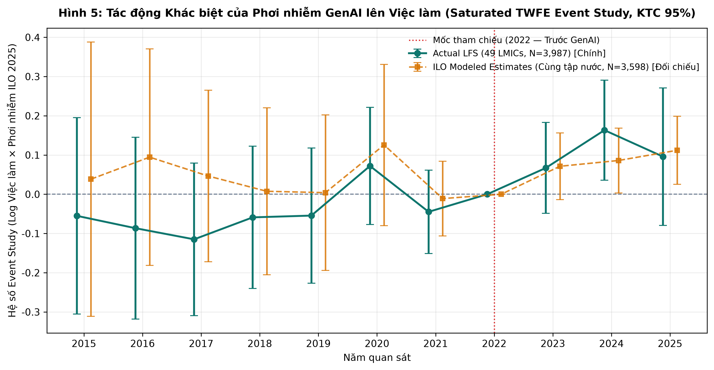
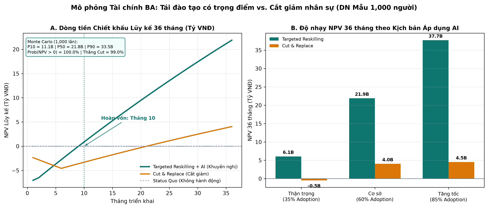

# AI Labor Shock & Skills Exposure Observatory (LMICs & Vietnam)

[](https://github.com/nguyenJRhung/ai-labor-shock-observatory/actions/workflows/ci.yml)

> **Executive Summary (BLUF — 30 giây):**  
> Các doanh nghiệp và nhà hoạch định chính sách tại các nền kinh tế thu nhập thấp & trung bình (LMICs, trong đó có Việt Nam) đang thiếu một công cụ định lượng để tách bạch **tác động thực của GenAI lên cơ cấu việc làm** khỏi nhiễu chu kỳ vĩ mô, và chuyển hóa tín hiệu đó thành **bài toán ROI tái đào tạo nhân sự (Reskilling NPV & Payback)**.  
> Dự án này xây dựng một **Hệ thống Quan sát Nhân quả & Mô phỏng Chiến lược Nhân sự** vận hành **0 đồng**, kết hợp dữ liệu thực tế từ **ILO 2025, ILOSTAT LFS, Anthropic Economic Index, GitHub Innovation Graph và World Bank WDI**, đối chiếu chéo chính xác giữa **Python (`pyfixest`) và R (`fixest`)**.

---

## 1. Kết quả Trọng tâm Đã Kiểm chứng Thực tế

### A. Tác động Nhân quả Vĩ mô trên 49 quốc gia LMICs (`mart_panel_causal_lfs`, $N = 3,987$)




- **Kiểm định Xu hướng Song song (Pre-trend 2015–2021):** Đạt (`Wald p = 0.274` trên Actual LFS), trong khi dữ liệu nội suy *ILO Modeled* (`124` nước, $N=9,450$) bị vi phạm (`p = 0.00051`) — khẳng định tầm quan trọng của việc dùng dữ liệu điều tra thực tế.
- **Tác động Hậu 2022 (`post_2022 × exposure_2025`) & 9 Kiểm định Độ bền vững:** Baseline không gia quyền ($\hat{\beta} = +0.1502, SE = 0.0715, p = 0.0362$) và WLS tỷ trọng nghề 2022 ($\hat{\beta} = +0.3046, p = 0.0007$) cùng Balanced Panel 2017–2024 ($\hat{\beta} = +0.1718, p = 0.0252$) dương có ý nghĩa. Tuy nhiên, khi kiểm soát xu hướng tuyến tính riêng theo từng nhóm nghề ($\hat{\beta} = +0.0769, p = 0.284$), so sánh trực tiếp Văn phòng `ISCO-4` vs. Tay chân `ISCO 7–9` ($\hat{\beta} = +0.0047, p = 0.848$), bỏ `ISCO-6` (`+0.0196, p = 0.785`), hoặc chạy **500 lần hoán vị FWL Randomization Inference (`p = 0.428`)**, kết quả trở về 0 về mặt thống kê — chứng minh giai đoạn 2023–2025 **chưa có làn sóng sa thải ròng do GenAI**, là cửa sổ vàng để tái đào tạo.
- **Đối chiếu chéo `5/5` mô hình Python `pyfixest` vs. R `fixest`:** Khớp tuyệt đối trên cả `Event Study`, `Pooled DiD`, `Occupation Linear Trends`, `Binary Clerical vs. Manual`, và `Triple-Diff Gender` (`max |Δβ| = 2.16e-15`, `max |ΔSE| = 3.83e-11`).
- **Chuyên sâu Việt Nam (`VNM`):** `2,760,619` GitHub developers cuối 2025 (`401.7` dev / 10k dân LĐ, tăng `+123.1%` từ 2022; lên `3,244,777` ở `2026-Q2`); Anthropic **AUI toàn cầu = `0.8605`** (**`2.3984`** nội khối LMICs); tương tác *Automation* chiếm `51.8%` vs. *Augmentation* `45.6%`; lao động nữ chịu phơi nhiễm gia quyền cao hơn nam (`0.2245` vs. `0.2071`, `Gender Gap = +0.0174`).

### B. Mô phỏng Tài chính BA: Doanh nghiệp Mẫu 1.000 Nhân sự Việt Nam (Kèm Monte Carlo & Gender Audit)



| Chiến lược hành động (Khung 36 tháng) | Đầu tư ban đầu | NPV Cơ sở | Monte Carlo P10 / P50 / P90 | ROI (%) | Hoàn vốn | Break-even / Gender Audit |
| :--- | ---: | ---: | ---: | ---: | :---: | :--- |
| **A. Status Quo (Giữ nguyên)** | 0 Tỷ | **0.00 Tỷ** | — | 0.0% | — | Chi phí cơ hội `-21.89 Tỷ` |
| **B. Cut & Replace (Cắt 34 người, khóa HITL)** | 1.89 Tỷ | **+4.05 Tỷ** | +3.37 / +4.22 / +5.04 Tỷ | 213.8% | Tháng 22 | `53.55%` người bị cắt là nữ (`+1.87 pp` vs DN) |
| **C. Targeted Reskilling + AI (520 người ISCO 2–4)** | 7.18 Tỷ | **+21.89 Tỷ** | **+11.06 / +21.78 / +33.51 Tỷ** | **305.0%** | **Tháng 10** | **Break-even 5.35%** (`100%` NPV > 0; **`99.0%` thắng Cut**) |

---

## 2. Kiến trúc Hệ thống 3 Lớp & Kho dữ liệu

```text
[5 Nguồn mở: ILO 2025 + ILOSTAT LFS/Modeled + Anthropic AEI + GitHub IG + WDI]
                                      │
                                      ▼  Lớp 1: ETL & SQL Warehouse (src/etl/ + sql/01..03)
                            [data/observatory.duckdb]
                                      │
                     ┌────────────────┴────────────────┐
                     ▼                                 ▼
Lớp 2: Causal Engine (src/causal/)          Lớp 3: BA & Financial Engine (src/business/)
- Saturated TWFE Event Study (Python & R)   - Workforce Diagnostics (Quỹ lương phơi nhiễm)
- Triple-Diff Gender & Heterogeneity        - NPV 36M, ROI %, Payback, Break-even Lift
- 9 Robustness, WLS & RI Proofs (R 5/5)      - Monte Carlo 1,000x & Gender Audit + HITL
                     │                                 │
                     └────────────────┬────────────────┘
                                      ▼
         [3-Tab Streamlit App (app/streamlit_app.py) + BA Policy Docs (docs/)]
```

---

## 3. Bộ Tài liệu Nghiệp vụ, Quản trị & Tự học (`docs/`)

- [00_Data_Coverage_Audit.md](docs/00_Data_Coverage_Audit.md) — Kiểm chứng độ phủ thực tế của 5 nguồn dữ liệu mở.
- [01_BRD_Problem_Framing.md](docs/01_BRD_Problem_Framing.md) — Tài liệu bài toán nghiệp vụ (BRD), phạm vi MVP và ánh xạ 10 tiêu chí Kinh tế – AI.
- [02_KPI_Tree_Metrics.md](docs/02_KPI_Tree_Metrics.md) — Cây KPI 3 tầng liên kết hệ số nhân quả vĩ mô với NPV/ROI doanh nghiệp.
- [03_Executive_Policy_Memo.md](docs/03_Executive_Policy_Memo.md) — Báo cáo 2 trang gửi Ban Giám đốc (CHRO/CFO) với số liệu và biểu đồ thực nghiệm.
- [04_Model_Governance_Card.md](docs/04_Model_Governance_Card.md) — Kiểm toán thiên kiến giới tính, giới hạn dữ liệu, Unit Economics & rào chắn Human-in-the-Loop.
- [05_Study_Guide_For_Interview.md](docs/05_Study_Guide_For_Interview.md) — Tài liệu tự học kiến thức SQL / Kinh tế lượng / Tài chính BA & 10 câu hỏi phỏng vấn thực chiến.

---

## 4. Hướng dẫn Chạy Toàn bộ Hệ thống & Mở Dashboard

```powershell
# 1. Tạo môi trường ảo & cài đặt thư viện
python -m venv .venv
.\.venv\Scripts\Activate.ps1
pip install -r requirements.txt

# 2. Chạy toàn bộ pipeline tái lập (ETL -> DuckDB -> EDA -> Causal -> R Verify -> BA ROI -> Pytest)
.\.venv\Scripts\python.exe -m src.etl.fetch_ilo_exposure
.\.venv\Scripts\python.exe -m src.etl.fetch_ilostat_lmics
.\.venv\Scripts\python.exe -m src.etl.fetch_wdi_github_aei
.\.venv\Scripts\python.exe -m src.etl.build_duckdb
.\.venv\Scripts\python.exe -m src.etl.generate_eda_charts
.\.venv\Scripts\python.exe -m src.causal.robustness_checks
Rscript src/causal/verify_in_r.R
.\.venv\Scripts\python.exe -m src.business.scenario_simulator
.\.venv\Scripts\pytest.exe -v

# 3. Khởi chạy ứng dụng tương tác Streamlit (3 Tabs)
.\.venv\Scripts\streamlit.exe run app/streamlit_app.py
```

---

## 5. Trạng thái Hoàn thành Lộ trình 12 Tuần

- [x] **Tuần 1:** Khởi tạo cấu trúc repo 3 lớp, thiết lập `.venv`, viết BRD + KPI Tree, kiểm chứng 5 nguồn dữ liệu mở ([docs/00_Data_Coverage_Audit.md](docs/00_Data_Coverage_Audit.md)).
- [x] **Tuần 2–4:** Hoàn thiện ETL toàn khối LMICs & kho dữ liệu `observatory.duckdb` (`sql/01_staging_harmonize.sql`, `02_mart_panel_causal.sql`, `03_mart_vietnam_ba.sql`) với `0` khóa trùng lặp.
- [x] **Tuần 5–6:** EDA đa chiều (*Gender Exposure Gap*, *Theory vs. Adoption*, *Vietnam Tech Trend*) và xuất 4 biểu đồ 300 DPI (`docs/figures/fig01`–`fig04`).
- [x] **Tuần 7–8:** Lõi Suy luận Nhân quả (`pyfixest`), Triple-Diff giới tính, 9 kiểm định phản bác & độ bền vững (Occ. Trends, WLS, Binary DiD, FWL RI) và đối chiếu chéo R `fixest` **5/5 mô hình** khớp tới `2.16e-15`.
- [x] **Tuần 9–10:** Mô hình tài chính `Reskilling ROI` (`src/business/`) & ứng dụng Streamlit 3 tab tích hợp cơ chế *Human-in-the-Loop* (`app/streamlit_app.py`).
- [x] **Tuần 11–12:** Bộ kiểm thử tự động `pytest`, GitHub Actions CI, `Makefile`, *Executive Policy Memo*, *Model Governance Card* và *Interview Study Guide*.
