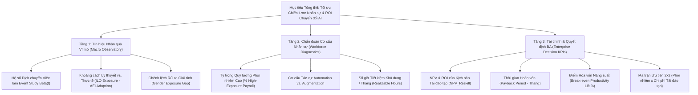

# Cây KPI 3 Tầng & Định nghĩa Thước đo (KPI Tree & Metrics Dictionary)

Tài liệu này liên kết chặt chẽ hai thế giới thường bị tách rời: **tín hiệu kinh tế lượng nhân quả ở cấp vĩ mô** và **chỉ số ra quyết định tài chính – nhân sự (P&L / NPV) ở cấp doanh nghiệp**.

---

## 1. Sơ đồ Cây KPI 3 Tầng

---

## 2. Từ điển Định nghĩa & Công thức KPI

### Tầng 1 — Tín hiệu Nhân quả Vĩ mô (Macro Observatory)

| Mã KPI | Tên chỉ số | Công thức / Phương pháp xác định | Nguồn dữ liệu | Ý nghĩa ra quyết định |
| :--- | :--- | :--- | :--- | :--- |
| **M-01** | **Differential Employment Shift ($\hat{\beta}_\tau$)** | $\ln(\text{Emp}_{c,o,t}) = \sum_{\tau \neq 2022} \beta_\tau (\text{Exposure}_o \times \mathbf{1}[t=\tau]) + \alpha_{c,o} + \gamma_{c,t} + \varepsilon_{c,o,t}$ | ILOSTAT LFS + ILO 2025 | Đo % thay đổi việc làm khác biệt tại nhóm nghề phơi nhiễm AI cao so với thấp sau 2022, đã khử sạch mọi cú sốc vĩ mô từng nước. |
| **M-02** | **Pre-Trend Validity Score** | Kiểm định đồng thời $H_0: \beta_{2016} = \dots = \beta_{2021} = 0$ ($p\text{-value} > 0.05$) | ILOSTAT LFS | Điều kiện cần để tin cậy suy diễn nhân quả; nếu vi phạm phải kích hoạt kiểm tra độ nhạy COVID-19. |
| **M-03** | **Theory-vs-Adoption Gap** | $\Delta_{\text{gap}}(c) = \overline{\text{Exposure}}^{\text{ILO2025}}_c - \text{Normalized Adoption}^{\text{AEI}}_c$ | ILO 2025 + Anthropic AEI + GitHub IG | Đo dư địa/độ trễ ứng dụng AI thực tế tại từng quốc gia LMICs so với mức độ phơi nhiễm lý thuyết. |
| **M-04** | **Gender Exposure Gap** | $\text{Exposure}^{\text{Female}}_{c} - \text{Exposure}^{\text{Male}}_{c}$ (gia quyền theo tỷ trọng việc làm từng nhóm nghề) | ILOSTAT (`SEX_F`/`SEX_M`) + ILO 2025 | Cảnh báo thiên kiến rủi ro tự động hóa nhắm vào lao động nữ (đặc biệt nhóm văn phòng ISCO-4). |

---

### Tầng 2 — Chẩn đoán Cơ cấu Nhân sự Doanh nghiệp (Workforce Diagnostics)

| Mã KPI | Tên chỉ số | Công thức tính | Ý nghĩa BA |
| :--- | :--- | :--- | :--- |
| **W-01** | **% Quỹ lương Phơi nhiễm Cao** | $\dfrac{\sum_{o \in \text{HighExp}} (N_o \times W_o)}{\sum_{o} (N_o \times W_o)} \times 100\%$ | Xác định phần chi phí nhân sự chịu tác động trực tiếp nhất nếu không tái thiết kế quy trình. |
| **W-02** | **Chỉ số Định hướng Vai trò (Automation / Augmentation Ratio)** | $\dfrac{\text{Số tác vụ Automation-prone}}{\text{Số tác vụ Augmentation-prone}}$ trong nhóm nghề $o$ | Phân biệt phòng ban cần **chuẩn hóa tự động hóa** với phòng ban cần **trang bị AI Copilot tăng năng suất**. |
| **W-03** | **Giờ công Giải phóng Thực tế / Tháng** | $\text{Hours\_Saved}_{o} = N_o \times H_{\text{tháng}} \times s_o^{\text{AI}} \times \rho_{\text{realize}}$ | Quy đổi điểm phơi nhiễm trừu tượng thành quỹ thời gian có thể tái đầu tư sang tác vụ giá trị cao ($\rho_{\text{realize}} \in [0.3, 0.7]$). |

---

### Tầng 3 — Chỉ số Tài chính & Quyết định BA (Enterprise Decision KPIs)

Trong khung thời gian đánh giá $M = 36$ tháng với tỷ lệ chiết khấu tháng $r_m = (1 + r_{\text{năm}})^{1/12} - 1$:

1. **Giá trị hiện tại ròng của chiến lược Tái đào tạo ($\text{NPV}_{\text{Reskill}}$):**
   $$\text{NPV}_{\text{Reskill}} = \sum_{m=1}^{M} \frac{\Delta \text{Value\_Productivity}_m - N_{\text{train}} \cdot C_{\text{AI\_seat}}}{(1 + r_m)^m} - \Big(N_{\text{train}} \cdot C_{\text{Reskill}} \cdot (1 + \text{overhead})\Big)$$
   - Trong đó $\Delta \text{Value\_Productivity}_m$ tính từ quỹ giờ tiết kiệm thực tế nhân với giá trị gia tăng theo giờ lương và hệ số khởi động (*ramp-up*) trong 3 tháng đầu.

2. **Tỷ suất hoàn vốn đào tạo ($\text{ROI}_{\text{Reskill}}$):**
   $$\text{ROI (\%)} = \frac{\text{PV(Net Benefits)} - \text{Upfront Investment}}{\text{Upfront Investment}} \times 100\%$$

3. **Thời gian hoàn vốn ($\text{Payback Period}$):**
   - Số tháng tối thiểu $m^*$ để tổng dòng tiền chiết khấu lũy kế $\ge 0$. Ngưỡng khuyến nghị cho doanh nghiệp Việt Nam: **$\le 12$ tháng** (Ưu tiên triển khai ngay), **$13\text{–}24$ tháng** (Thí điểm có chọn lọc), **$> 24$ tháng** (Trì hoãn).

4. **Điểm hòa vốn nâng suất ($\text{Break-even Productivity Lift}$):**
   - Tỷ lệ tăng năng suất tối thiểu (%) mà một nhân sự sau đào tạo phải đạt được để $\text{NPV}_{\text{Reskill}} = 0$. Giúp CFO kiểm tra tính khả thi thực tế (*"Chỉ cần tăng 4.2% năng suất là hòa vốn đào tạo + bản quyền AI"*).

5. **So sánh 3 kịch bản hành động (Decision Matrix):**
   - **Kịch bản A — Giữ nguyên (Status Quo):** Chi phí trực tiếp bằng 0, nhưng chịu chi phí cơ hội mất năng suất so với đối thủ.
   - **Kịch bản B — Cắt giảm & Tuyển thay thế (Cut & Replace):** Cộng dồn chi phí đền bù, tuyển mới và mất năng suất bàn giao (`replacement_cost_months_salary` $\times$ lương tháng), kèm rủi ro gián đoạn vận hành.
   - **Kịch bản C — Tái đào tạo có trọng điểm (Targeted Reskilling):** Ưu tiên nhóm nằm trong góc phần tư **[Phơi nhiễm AI cao × Chi phí tái đào tạo hợp lý]** và bảo vệ nhóm bắt buộc **Human-in-the-Loop**.
