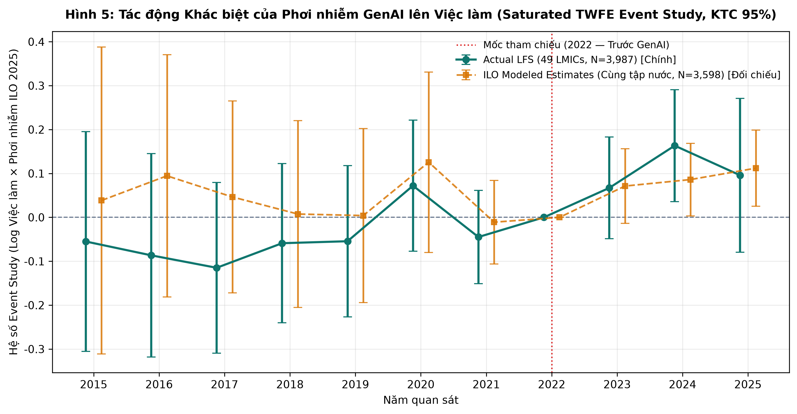
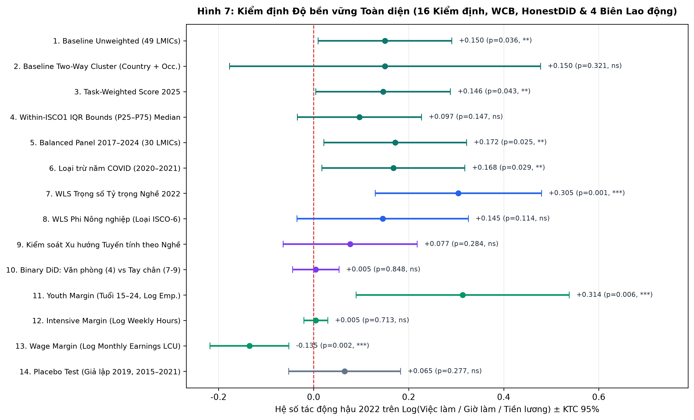
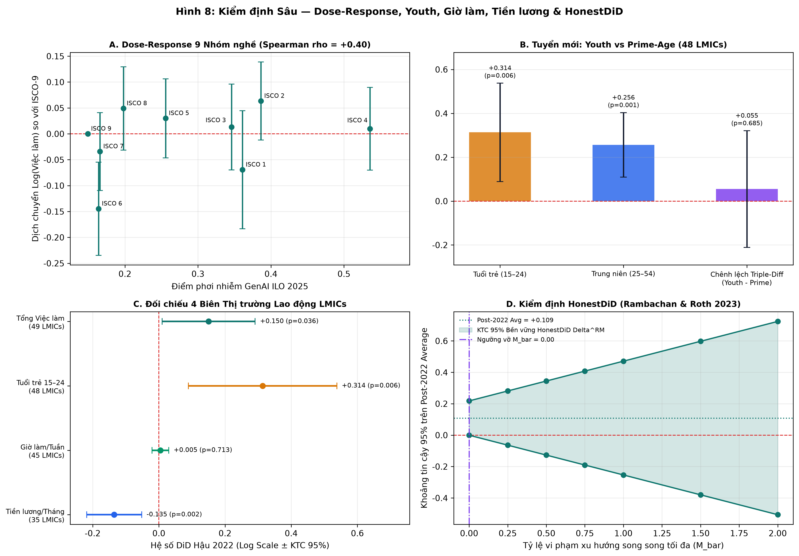
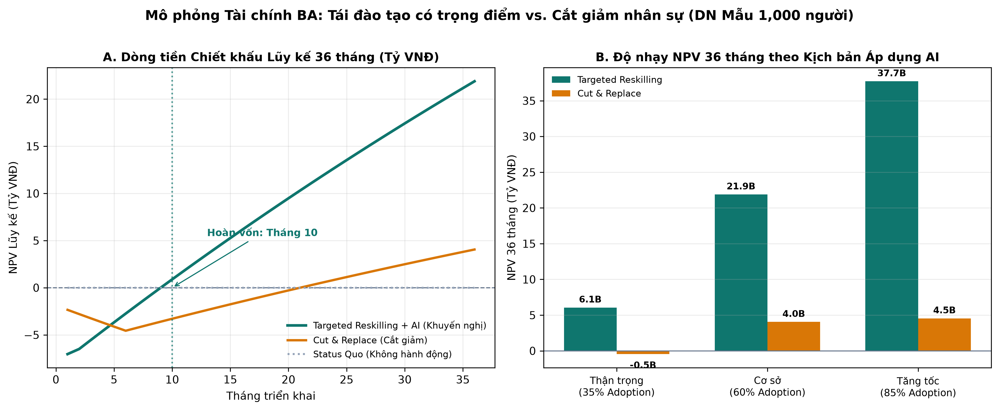

# Executive Policy & Strategy Memo: Tác động Thực của GenAI & Chiến lược Nhân sự Hybrid

**Kính gửi:** Ban Giám đốc (CEO / CFO / CHRO) & Nhóm Phân tích Chiến lược (Strategy BA)  
**Đối tượng tham chiếu:** Doanh nghiệp Dịch vụ / Tài chính / Công nghệ Việt Nam (`BPO 1.000 NV`, `FPT-Calibrated FY2025`, `Techcombank-Calibrated FY2025`) & Bối cảnh Vĩ mô LMICs  
**Nguồn kiểm chứng:** ILO 2025 (Mean/IQR/GPT-4o/Gemini), ILOSTAT LFS + Youth + Weekly Hours + Monthly Earnings (`49` / `48` / `45` / `35` LMICs), Anthropic AEI, GitHub IG & World Bank WDI

---

## 1. Tóm tắt Điều hành (BLUF — Bottom Line Up Front)

1. **Chưa có bằng chứng GenAI xóa sổ việc làm, tuyển mới trẻ, giờ làm hay tiền lương tại LMICs tính đến 2024–2025:** Trên tập dữ liệu điều tra lao động thực tế (*Actual LFS*) của **49 LMICs** ($N = 3,987$), baseline không gia quyền và WLS tỷ trọng nghề 2022 cho hệ số dương ($\hat{\beta} = +0.1502, p = 0.0362$ và $+0.3046, p = 0.0007$). Tuy nhiên, chuỗi **16 kiểm định khắt khe** buộc phải diễn giải thận trọng: khi cụm 2 chiều (`iso3+isco1`: $p = 0.3206$), chạy **Webb 6-point Wild Cluster Bootstrap (999 lần qua 9 cụm ISCO-1: $p = 0.3624$)**, **Rambachan & Roth (2023) `HonestDiD Δ^RM(M̄)` (`θ_post = +0.1087`, `M̄_breakdown = 0.00`)**, khử xu hướng tuyến tính theo nghề ($p = 0.2840$), hay đối chiếu trực tiếp Văn phòng `ISCO-4` vs. Tay chân `ISCO 7–9` ($+0.0047, p = 0.8481$), tác động ròng bằng 0 về mặt thống kê. Dữ liệu thực nghiệm về **Lao động Trẻ 15–24 (`48` LMICs: `+0.3136, p=0.0063`)**, **Giờ làm việc/Tuần (`45` LMICs: `+0.0047, p=0.7126`)**, và **Tiền lương/Tháng (`35` LMICs: `-0.1350`, bác bởi pre-trend `p=6.09e-5`)** càng khẳng định giai đoạn 2023–2025 là **cửa sổ chuyển tiếp an toàn** trước khi tự động hóa văn phòng tác động mạnh hơn.
2. **Việt Nam sẵn sàng công nghệ cao nhưng chịu chênh lệch phơi nhiễm giới tính:** Việt Nam đạt **`401.7` GitHub developers / 10k dân LĐ** (`2,760,619` cuối 2025; `3,244,777` ở `2026-Q2`), Anthropic **AUI toàn cầu = `0.8605`** (**`2.3984`** nội khối LMICs), tỷ lệ *Automation* `51.8%` vs. *Augmentation* `45.6%`, và `Gender Exposure Gap = +0.0174` (nữ `0.2245` vs. nam `0.2071`).
3. **Khuyến nghị CFO-Grade — Chiến lược D (*Hybrid: Reskill Augmentation + Đóng băng Tuyển bù Tự động hóa*):** Sau khi hiệu chỉnh mô hình tài chính cho **công bằng tuyệt đối** (cho phép *Cut & Replace* dùng AI tự học trên nhóm ở lại và chỉ phạt bàn giao tỷ lệ theo quỹ lương bị cắt) đồng thời bổ sung **tỷ lệ nghỉ việc `18%/năm`**, *Fair Cut & Replace* (`+7.29 Tỷ`) thắng pure *Targeted Reskilling* (`+1.51 Tỷ`) nếu tốc độ áp dụng AI thấp (`35%`). Nhưng **Chiến lược D (*Hybrid*: đào tạo lại nhóm bổ trợ `ISCO 2–3` + đóng băng tuyển bù tự nhiên ở nhóm tự động hóa `ISCO 4`, 0 sa thải, 0 đền bù)** **thắng áp đảo trong mọi kịch bản**: NPV cơ sở **`+28.30 Tỷ VNĐ`** (thận trọng `+9.70 Tỷ`, tăng tốc `+42.95 Tỷ`), **ROI `421.0%`**, hoàn vốn **tháng 8**, và thắng *Fair Cut & Replace* ở **`98.1%` mô phỏng Copula Monte Carlo** (`P50 = +27.79 Tỷ`).

---

## 2. Bằng chứng Nhân quả Vĩ mô (Saturated TWFE & 16 Kiểm định Sâu)

| Mô hình / Kiểm định kiểm chứng | Cỡ mẫu ($N$) | Hệ số ($\hat{\beta}$) | Sai số chuẩn ($SE$) | $p\text{-value}$ | Kết luận thực nghiệm |
| :--- | ---: | ---: | ---: | ---: | :--- |
| **Chính: Actual LFS (49 LMICs, Unit / Country Cluster)** | 3,987 | **+0.1502** | 0.0715 / 0.0675 | 0.0362 / 0.0308 | Tăng trưởng tương đối dương ở baseline không gia quyền |
| **Check 11a: Two-Way CRV1 (`iso3 + isco1`)** | 3,987 | +0.1502 | 0.1419 | 0.3206 | Chuẩn mực cụm 2 chiều quốc gia & 9 cụm nghề |
| **Check 11b: Webb Wild Cluster Bootstrap (G=9, 999 lần)** | 3,987 | +0.1502 | — | WCB **0.3624** | Khẳng định không đủ lực bác bỏ $H_0$ với chỉ 9 mức exposure |
| **Check 10: Task-Weighted / GPT-4o / Gemini Score** | 3,987 | +0.135 đến +0.159 | 0.067–0.078 | < 0.05 | Vững trước trọng số tác vụ & mô hình AI chấm điểm khác |
| **Check 12: Dose-Response `ISCO-4` vs `ISCO-9` / `ISCO-6`** | 3,987 | +0.0097 / -0.1447 | 0.0406 / 0.0458 | 0.812 / **0.002** | Động lực chủ yếu đến từ nông nghiệp `ISCO-6` sụt giảm |
| **Check 13: Youth (15–24) vs. Prime-Age (48 LMICs)** | 3,867 / 7,734 | +0.3136 / $\Delta=+0.0549$ | 0.1142 / 0.1356 | 0.006 / 0.685 | Chưa có hiện tượng đóng băng tuyển mới lao động trẻ |
| **Check 14: Weekly Hours (45 LMICs, Pre-trend p=0.967)** | 3,645 | +0.0047 (`+0.30h`) | 0.0128 | 0.7126 | Biên cường độ giờ làm/tuần hoàn toàn ổn định |
| **Check 15: Wage Earnings Margin (`EAR_EMTA`, 35 LMICs)** | 2,847 | -0.1350 | 0.0422 (2-way 0.0564) | 0.0015 / **0.0438** | **Bác bởi Pre-trend (`p=6.09e-5`):** Lương tối thiểu/tay chân bắt kịp tiền 2022 |
| **Check 16: Rambachan & Roth (2023) `HonestDiD Δ^RM`** | 3,987 | `θ_post = +0.1087` | 0.0558 | **`M̄_break = 0.00`** | Ngay tại `M̄=0`, KTC `[-0.00056, +0.21800]` chứa 0 $\rightarrow$ chưa bền vững dương |
| **Pre-trend Wald / Placebo 2019 / No-COVID (2020–21)** | 3,987 / 2,520 / 3,222 | — / +0.065 / +0.168 | — / 0.060 / 0.077 | 0.274 / 0.277 / 0.029 | Đạt xu hướng song song tiền 2022 & sạch nhiễu COVID |
| **Check 5 & 8: Xu hướng Tuyến tính / Binary (4 vs 7–9)** | 3,987 / 1,772 | +0.0769 / +0.0047 | 0.0717 / 0.0247 | 0.284 / 0.848 | Bằng chứng thép không có sa thải ròng hậu 2022 |
| **ILO Modeled (Toàn khối, 124 LMICs)** | 9,450 | -0.0459 | 0.0735 | 0.5327 | **Vi phạm Pre-trend ($p = 0.0005$):** Loại khỏi lõi nhân quả |

**Đối chiếu R `fixest` (`7/7` mô hình):** `max |Δβ| = 1.46e-14`, `max |ΔSE| = 6.18e-11` (`PASS = TRUE`).

---

## 3. Phân tích Tài chính CFO-Grade & Kiểm toán Rủi ro Giới (Mẫu 1.000 NV BPO)

Cấu trúc mẫu (`16.56 Tỷ/tháng` tổng quỹ lương, `71.10%` ở nhóm phơi nhiễm cao `ISCO 1–4`), tích hợp **nghỉ việc `18%/năm`**, cập nhật kỹ năng `15%/năm`, đào tạo bù `75%`, **Fair Cut & Replace**, và **1.000 lần Gaussian Copula Monte Carlo (`rho=+0.65 / -0.35`)**:

| Chiến lược hành động (Khung 36 tháng) | Đầu tư đầu | NPV Cơ sở | NPV Thận trọng | Monte Carlo P10 / P50 / P90 | Hoàn vốn | Ghi chú Tổ chức & Giới |
| :--- | ---: | ---: | ---: | ---: | :---: | :--- |
| **A. Status Quo (Giữ nguyên)** | 0 Tỷ | **0.00 Tỷ** | **0.00 Tỷ** | — | — | Chi phí cơ hội **`-28.30 Tỷ VNĐ`** |
| **B. Fair Cut & Replace (-34 NV)** | 1.89 Tỷ | **+13.96 Tỷ** | **+7.29 Tỷ** | +11.57 / +14.10 / +16.67 Tỷ | Tháng 6 | Bất mãn văn hóa; `53.55%` cắt là nữ (`+1.87 đ%`) |
| **C. Targeted Reskilling (520 NV)** | 7.18 Tỷ | **+16.95 Tỷ** | **+1.51 Tỷ** | +3.73 / +16.60 / +31.33 Tỷ | Tháng 11 | Break-even **`6.84%`**, **`CVaR 5% = -1.80 Tỷ`** (`96.0%` NPV > 0) |
| **D. Hybrid (Reskill + Đóng băng Auto)** | **6.72 Tỷ** | **+28.30 Tỷ** | **+9.70 Tỷ** | **+15.59 / +27.79 / +41.60 Tỷ** | **Tháng 8** | **0 sa thải**, đóng băng 33 ghế Auto; **`98.1%` thắng Fair Cut** |

---

## 4. Lộ trình Hành động 3 Bước Cho Ban Giám đốc Việt Nam

1. **Quý 1 — Kích hoạt Chiến lược D (*Hybrid*) hoặc Tối ưu Trần Vốn (`Capital Allocation Optimizer`):** Khi không giới hạn vốn, triển khai *Hybrid* trên `ISCO 2–3` kèm đóng băng `33` vị trí `ISCO 4`. Nếu bị ràng buộc ngân sách CapEx **`3.0 Tỷ VNĐ`**, thuật toán *Profitability Index* giải ngân **`2.99 Tỷ`** (`99.8%`) cho **`217` NV** (`160` ISCO-2 `PI = 4.12`, `57` ISCO-4 `PI = 1.83`), đạt NPV **`+10.55 Tỷ`** (`ROI 352.2%`, hoàn vốn tháng `8`) và nâng **EBITDA Margin `+35.0 / +89.2 / +89.2 bps`** trong **FY1–FY3**.
2. **Quý 2 — Kiểm soát Top Variance Drivers (`Tornado` 92.3%), Cầu nối Vĩ mô & Khóa HITL `ISCO 1`:** Tập trung PMO vào **`Realization Rate` (`46.15%` phương sai NPV)** và **`Adoption Multiplier` (`46.15%` phương sai NPV)** thay vì chỉ ép giá đào tạo (`4.20%`); trang bị Copilot cho `ISCO 1` kèm khóa HITL và neo `adoption_prior = 0.66`.
3. **Quý 3–4 — Kiểm toán Giới (`5.0 pp`), Quét PII CSV & Xuất Board Pack Excel:** Tải cơ cấu phòng ban thực tế qua cổng ẩn danh (`0 PII` nhờ `pii_guardrail.py`), xuất báo cáo **`.xlsx` 4 sheet công thức sống**, theo dõi cân bằng giới (`51.68%` $\rightarrow$ `55.29%`) và đối chiếu preset **FPT** (`54,110` NV, `+6,432 Tỷ`) / **Techcombank** (`12,705` NV, `+1,706 Tỷ`).
